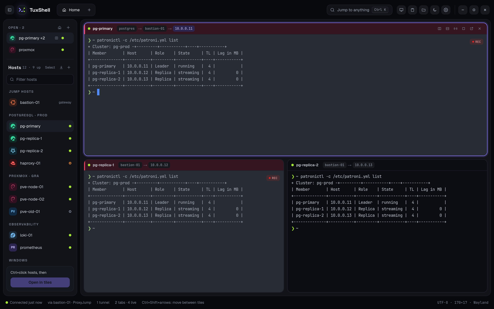
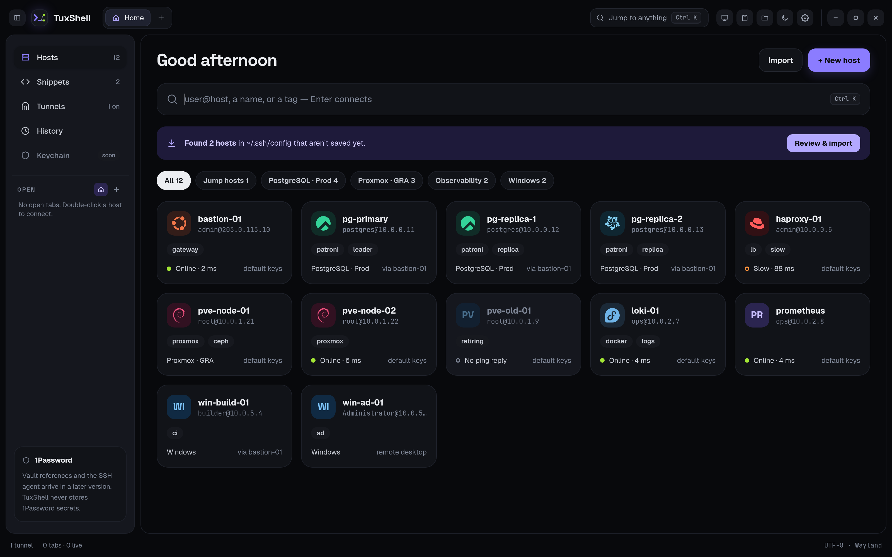
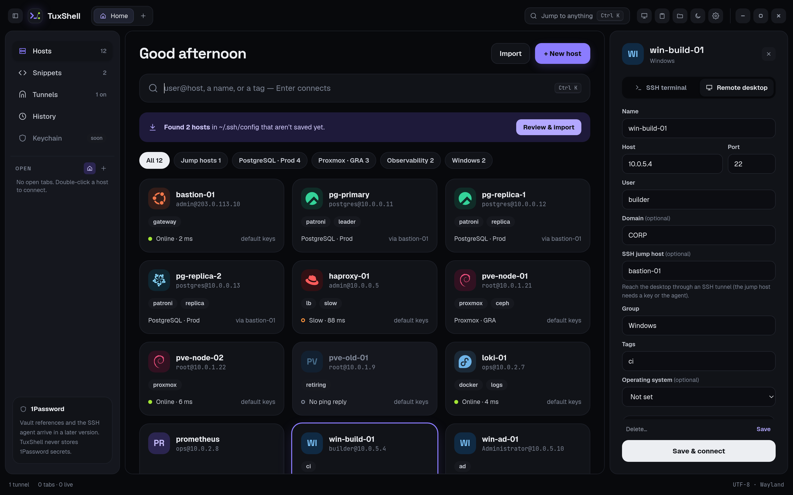
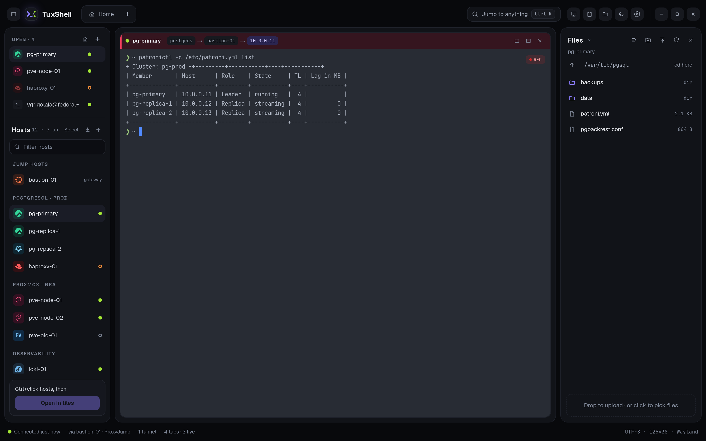
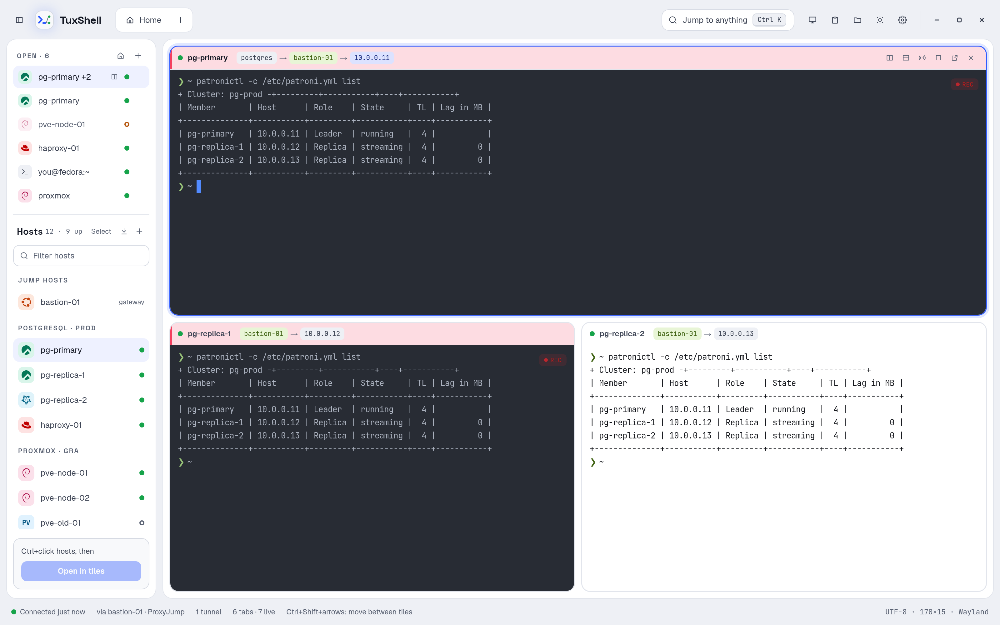

# TuxShell

A free, open-source SSH connection manager for Linux.

TuxShell keeps your hosts in one place and connects with the system `ssh`, so your
`~/.ssh/config`, keys, agents and jump hosts work as they already do.

## Screenshots


*Split view: open tabs and hosts in the left panel, up to four panes per tab.*


*Home: your hosts by group, with status, search and quick connect.*


*Remote desktops (RDP) sit next to your SSH hosts, with an SSH jump host if you need one.*


*File browser beside the terminal: upload, download, rename and edit.*


*Dark and light themes.*

## Features

- **Home**: a start page with your hosts, snippets and tunnels. Double-click Hosts to
  open the host list next to your sessions.
- **Hosts**: saved hosts with groups, tags, jump hosts (ProxyJump) and identity files.
  Filter, bulk select and delete. Optional operating system per host, shown with its logo
  (Ubuntu, Debian, RHEL, AlmaLinux, Rocky, Fedora and more).
  Hosts without a saved user ask for one when you connect, with an option to save it.
- **Host status**: a dot shows which hosts answer ping (up, slow or down). Checked with
  ICMP, never by opening SSH connections; can be turned off. Test a host's login from its form.
- **Quick connect** (Ctrl+K): fuzzy search your hosts, snippets, tunnels and actions, or
  type `user@host:port`. Open a result in a split.
- **Snippets**: saved commands, pasted into the terminal from Ctrl+K. They never run until
  you press Enter.
- **Tunnels**: local port forwards and SOCKS proxies through a saved host, listening on
  127.0.0.1 only. Password-only hosts can share an open terminal's connection.
- **Tabs and split view**: up to four panes per tab. Merge tabs into a split, move a pane
  out to its own tab, maximize a pane, drag dividers to resize. Open tabs are listed in the
  left panel above your hosts (or shrink to a strip of icons when it's hidden); drag to
  reorder them. Prefer the classic strip? Preferences → General → Open tabs.
- **Organize your hosts**: drag groups and hosts to put them in your own order, or into
  another group. The same with the keyboard (Alt+↑/↓) and from the right-click menu.
- **Remote desktops (RDP)**: connect to Windows machines like any other host. Open them in
  their own window (FreeRDP 3: shared folders, copy and paste of text and files, sound and
  microphone, quality presets, RD Gateway, multiple monitors) or inside a TuxShell tab (beta,
  built in: copy and paste of text and files, resizes with the tab). Certificates are pinned
  and you're warned if one changes. RDP hosts can go through an SSH jump host, and Remmina
  connections import with their settings.
- **Terminal profiles**: per-host colours, background image, pane header colour, scrolling
  and bell options, and a command to run on connect.
- **History and recording**: Home → History lists your connections (never commands or
  output). Optionally record a session's screen output and play it back inside TuxShell.
- **Saved passwords**: optional, kept only in your system keyring (see below).
- **Broadcast typing** (Ctrl+Shift+B): type into all panes of a tab at once, leaving
  out any pane you choose.
- **Shared connections**: new panes, splits and the file browser reuse an open SSH
  connection, so you log in once.
- **File browser** (Ctrl+Shift+E): browse the focused pane's host, download, upload with a
  file picker or drag-and-drop. Rename, create folders, delete and change permissions, or
  edit a file in your desktop editor and upload it back. Never overwrites files on either
  side unasked.
- **Import and export**: import from `~/.ssh/config` (usernames optional), CSV/TSV, Excel
  (.xlsx), MobaXterm, Remmina, PuTTY (Linux or a Windows .reg export) and Ansible INI
  inventories, with a preview of every host before it's saved. A ready-to-fill CSV template
  is included. Export as TuxShell JSON, CSV or ssh_config (Preferences → Hosts). Exports never
  contain passwords; imported passwords are kept only if you allow saving passwords.
- **Clipboard history** (Ctrl+Shift+H): encrypted at rest with a key in your keyring.
  Skips password- and token-looking text. Pin and edit clips, choose how long they're kept.
  Each clip shows which host it was copied from.
- **Preferences** (Ctrl+,): font (bundled or any installed monospace font), size, spacing,
  weights, cursor, colour schemes (Solarized, Dracula, Nord, Gruvbox, One Dark, Tango…),
  scrollback, copy on select, right-click paste, bell, local shell. Saved to
  `~/.config/tuxshell/settings.json`.
- **Terminal menu** (right-click): copy, paste, set title, split, open in new tab, read
  only, scrollbar, zoom. Ctrl+mouse wheel zooms text.
- **Dark and light themes**, or follow the system.
- **About and updates** (Preferences → About): the version and project links. Check for
  updates on request and at startup (on by default; turn it off in Preferences → About). TuxShell only
  links to the new release; it never downloads or installs anything itself.

All shortcuts are listed in Preferences → Shortcuts.

## Install

Download the package for your distribution from the
[releases page](https://github.com/vgrigolaia/tuxshell/releases):

```sh
# Fedora, RHEL, AlmaLinux, Rocky Linux
sudo dnf install ./tuxshell-1.2.1-1.x86_64.rpm

# Debian, Ubuntu
sudo apt install ./tuxshell_1.2.1-1_amd64.deb
```

Or run the AppImage on any distribution:

```sh
chmod +x TuxShell-1.2.1-x86_64.AppImage
./TuxShell-1.2.1-x86_64.AppImage
```

Supported: Fedora 39+, RHEL/Alma/Rocky 10, Debian 13+ and Ubuntu 24.04+. TuxShell needs
GTK 4 and WebKitGTK 6.0. Remote hosts need GNU `find` for the file browser.

Remote desktops in their own window use FreeRDP 3 (`freerdp` on Fedora, `freerdp3-x11` on
Debian and Ubuntu), which the packages recommend and install where available. Remote desktops
in a tab need nothing extra.

## Where your data lives

| What | Where |
|---|---|
| Hosts | `~/.local/share/tuxshell/hosts.db` |
| Clipboard history (encrypted) | `~/.local/share/tuxshell/clipboard.db` |
| Clipboard key | your desktop keyring, as "TuxShell" |
| Preferences | `~/.config/tuxshell/settings.json` |
| Terminal background images | `~/.local/share/tuxshell/backgrounds/` |
| Session recordings (only if you record) | `~/.local/share/tuxshell/recordings/` |

Saved passwords, if you allow them, are in your desktop keyring too (see below). TuxShell
never writes passwords to its own files.

## Passwords and security

TuxShell can log you in three ways (Preferences → Security):

- **SSH keys or your ssh agent** (recommended): nothing secret is stored by TuxShell.
- **1Password** (coming): only `op://` references are stored; the password stays in your vault.
- **Saved passwords**, for servers that only accept passwords. *Allow saving passwords* is on by
  default (turn it off in Preferences → Security). A password is saved when you type it into a
  host, tick *Remember* at a password prompt, or import a file that contains it. Passwords are stored encrypted in your system keyring (GNOME Keyring
  or KWallet) and unlocked when you log in to your desktop. Anyone using your logged-in session
  can use them.

When ssh asks for a password, TuxShell answers through ssh's own `SSH_ASKPASS` mechanism over a
private socket, so the password never appears in ssh's command line, its environment or the
terminal. Only the host's own ssh gets its password: prompts from jump hosts, host key questions
and key passphrases are shown in the terminal as usual. A saved password is tried once; if it's
refused, TuxShell asks you instead.

## Build from source

Requirements: Go 1.26+, Node.js 22+, [Task](https://taskfile.dev) and the Wails v3 CLI
(`go install github.com/wailsapp/wails/v3/cmd/wails3@v3.0.0-beta.28`).

System packages:

```sh
# Fedora
sudo dnf install gcc pkgconf-pkg-config gtk4-devel webkitgtk6.0-devel

# Debian 13+ / Ubuntu 24.04+
sudo apt install build-essential pkg-config libgtk-4-dev libwebkitgtk-6.0-dev
```

Then:

```sh
task dev       # run with live reload
task build     # build bin/tuxshell
task package   # build .rpm, .deb and AppImage into bin/
task tools     # once: golangci-lint and gitleaks for task lint
task lint      # golangci-lint, gitleaks secret scan, svelte-check
task test      # Go tests
```

If the window stays blank on Wayland, try `WEBKIT_DISABLE_DMABUF_RENDERER=1 task dev`.

## Contributing

Bug reports and pull requests are welcome. See [CONTRIBUTING.md](CONTRIBUTING.md); pull
requests need a one-time [Contributor License Agreement](CLA.md).

## License

TuxShell is free software under the [GNU General Public License v3.0 or later](LICENSE).

Operating system logos are from [Simple Icons](https://simpleicons.org) (CC0 1.0). They are
trademarks of their owners and are used only to identify each system. The TuxShell name and
logo are covered by [TRADEMARKS.md](TRADEMARKS.md).
